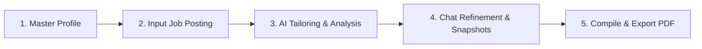

<div align="center">

  

  # BuildR

  ### **Create ATS-Optimized, Publication-Quality Resumes Tailored by AI**

  <p align="center">
    <a href="https://www.python.org/downloads/"></a>
    <a href="https://flask.palletsprojects.com/"></a>
    <a href="https://ai.google.dev/"></a>
    <a href="https://tectonic-typesetting.github.io/"></a>
    <a href="https://docs.pytest.org/"></a>
    <a href="LICENSE"></a>
  </p>

  <p align="center">
    <a href="#-key-features">Key Features</a> •
    <a href="#-screenshots">Screenshots</a> •
    <a href="#-local-dependencies--software-stack">Dependencies</a> •
    <a href="#-system-architecture">Architecture</a> •
    <a href="#-installation--local-setup">Installation</a> •
    <a href="#-usage-workflow">Usage</a> •
    <a href="#-configuration">Configuration</a> •
    <a href="#-local-first--privacy">Privacy</a>
  </p>

</div>

---

## 📌 Overview

**BuildR** is an AI-powered Master Resume Builder and job-tailoring engine designed for modern developers and job seekers.

Traditional resume management is fragmented: maintaining dozens of slightly divergent Word docs or PDFs easily leads to outdated credentials, formatting inconsistencies, and broken layouts.

BuildR solves this with a **single source of truth designed to run 100% locally on your computer**:
1. You maintain **one comprehensive Master Profile** with all your career history, projects, skills, education, and credentials.
2. For every target position, BuildR analyzes the job posting and uses **Google Gemini** to intelligently rephrase bullet points, highlight relevant accomplishments, and surface missing keywords.
3. Your final tailored resume is compiled on your machine using **Tectonic LaTeX** into an elegant, ATS-friendly, publication-grade PDF.

> **Zero Cloud Deployment Required**: BuildR is a local-first application. There is no remote database, no cloud user accounts, and no hosting required. All your profile information, drafts, session history, and generated PDFs stay private and stored locally on your own machine.

> **Zero-Hallucination Guarantee**: BuildR enforces a strict **anti-fabrication pipeline**. The AI is physically restricted from inventing companies, skills, or metrics that do not exist in your master profile.

---

## ✨ Key Features

- **🎯 Single Master Profile**
  Manage all personal details, work experiences, education, open-source projects, technical skills, certifications, and awards in one structured database.
- **⚡ AI-Powered Tailoring Workspace**
  Paste a job description or provide a job posting URL. BuildR scrapes and extracts requirements, matches your profile against keywords, and rephrases your impact bullets to align with the target role.
- **🛡️ Strict Anti-Fabrication Safeguards**
  Unlike generic AI wrappers, BuildR includes an in-memory post-generation sanitizer that cross-references all generated entities against your Master Profile. Any hallucinated metrics or skills are filtered out, and missing role requirements are surfaced cleanly into a "Skills to Acquire" advisory list.
- **💬 Interactive AI Chat Refinement**
  Collaborate with the AI directly inside a dedicated scratchpad workspace. Ask for punchier bullets, adjust emphasis toward specific frameworks or metrics, and iterate until the draft is perfect.
- **📸 Named Draft Snapshots**
  Save checkpoints of your tailored drafts as you iterate. Compare iterations and roll back to previous snapshots with one click.
- **📄 One-Page Optimization Intelligence**
  Avoid messy 1.1-page resumes. If your content slightly spills over, BuildR automatically applies subtle typesetting adjustments: tightening line heights, pruning redundant bullets, and deduplicating tech stacks.
- **🖋️ Publication-Grade LaTeX Typesetting**
  Compiled locally via the **Tectonic** modern LaTeX engine. Delivers crisp typography, accurate margins, and optimal readability for both human recruiters and Automated Tracking Systems (ATS).
- **📚 Versioned Resume Library**
  Every generated resume is preserved locally in your library with both its final PDF and reproducible `.tex` source code. Download, rename, duplicate, or delete anytime.
- **📥 PDF & DOCX Resume Importer**
  Already have an existing resume? Upload your PDF or DOCX file to automatically parse and populate your Master Profile using multimodal text extractors.

---

## 🖼️ Screenshots

<div align="center">

### Home Dashboard
*Quick access to your Master Profile, AI Tailoring workspace, and recent resume generations.*
<br/>


<br/><br/>

### Master Profile Editor
*Structured rich-text editing for work experience, projects, skills, education, and certifications.*
<br/>


<br/><br/>

### AI Tailoring & Analysis Workspace
*Analyze target job postings, inspect keyword match scores, and generate tailored resumes.*
<br/>


</div>

---

## 📦 Local Dependencies & Software Stack

BuildR runs entirely on your local machine. Below is the complete catalog of all system utilities, binaries, and Python packages that run locally on your PC.

### 1. System-Level Prerequisites

| Tool | Recommended Version | What It Does on Your PC |
|---|:---:|---|
| **Python** | `3.10+` | Runs the Flask backend, Pydantic data validation, AI service layer, and local tests. |
| **Tectonic CLI** | `v0.15.0+` | A fast, self-contained modern XeTeX LaTeX engine that compiles `.tex` templates into PDFs on your PC. It downloads necessary packages automatically into a local cache directory (`.tectonic/`) on first run—meaning you **do not** need to install a heavy 5GB+ TeX Live or MiKTeX distribution. |
| **Git** | `Any modern version` | Used to clone the repository to your local drive. |
| **Modern Browser** | Chrome / Firefox / Edge / Brave / Safari | Renders the single-page application interface and displays real-time PDF previews. |

### 2. Python Packages (`requirements.txt`)

When you run `pip install -r requirements.txt`, the following packages are installed into your Python environment:

| Package | Version Constraint | Role & Execution on Your PC |
|---|:---:|---|
| **`flask`** | `>=3.1, <4` | Core web framework. Powers the local HTTP server (`127.0.0.1:5000`), routing, REST endpoints, and file serving. |
| **`pydantic`** | `>=2.13, <3` | Strict data validation and schema definitions for your Master Profile, Tailored Profiles, and AI output validation. |
| **`openai`** | `>=1.50, <3` | Official SDK client used to communicate with Google Gemini's OpenAI-compatible API endpoint (`gemini-3.8-flash`). |
| **`jinja2`** | `>=3.1, <4` | Template engine with customized delimiter syntax used to dynamically assemble clean LaTeX (`.tex`) resume source files. |
| **`pypdf`** | `>=6.14, <7` | Local text and layout extractor that parses existing `.pdf` resumes uploaded by the user to populate the Master Profile. |
| **`python-docx`** | `>=1.2, <2` | Extracts headings, paragraphs, and lists from user-uploaded Microsoft Word (`.docx`) resumes for parsing. |
| **`beautifulsoup4`** | `>=4.15, <5` | Local HTML scraper and DOM cleaner that extracts structured job descriptions when you paste a public job posting URL. |
| **`requests`** | `>=2.34, <3` | HTTP client used locally to fetch web pages for job-posting scraping. |
| **`psutil`** | `>=5.9, <7` | Measures process memory usage (RSS) during file parsing to ensure efficient local memory footprint. |
| **`python-dotenv`** | `>=1.2, <2` | Automatically loads your local `.env` configuration file into Python's environment variables. |

### 3. Development & Testing Packages (`requirements-dev.txt`)

| Package | Version Constraint | Role & Execution on Your PC |
|---|:---:|---|
| **`pytest`** | `>=9.1, <10` | Test framework that executes the 187 automated tests locally (testing routes, sanitizers, LaTeX escaping, session management, and parsers). |

### 4. Local Storage & File Footprint

All user data is saved directly on your local hard drive inside the `storage/` directory (which is strictly `.gitignore`d):

- `storage/profile.json`: Your master career profile saved in clean, human-readable JSON format.
- `storage/resumes/<timestamp>_<title>/`: Local folder containing each generated `.pdf`, `.tex` source, and `metadata.json`.
- `storage/sessions/<session_id>/`: Scratch workspace containing draft iterations, chat logs, and snapshots.
- `.tectonic/`: Local cache directory where Tectonic caches downloaded LaTeX packages for fast offline recompilation.

---

## 🏗️ System Architecture

BuildR adheres to a strict design principle: **"AI Decides Content, Code Renders Documents"**. The LLM never outputs raw LaTeX code, eliminating compilation crashes, escaping errors, and template injection vulnerabilities.

```
┌─────────────────────────────────────────────────────────────┐
│                    Single-Page App (SPA)                    │
│   Vanilla JS • CSS Design System • TipTap Rich Text • PDF   │
└──────────────────────────────┬──────────────────────────────┘
                               │ Local REST API (127.0.0.1:5000)
                               ▼
┌─────────────────────────────────────────────────────────────┐
│                       Flask App (app.py)                    │
└──────┬───────────────────────┬──────────────────────────────┘
       │                       │
       ▼                       ▼
┌──────────────┐        ┌─────────────────────────────────────┐
│ Local Disk   │        │          Services Pipeline          │
│ profile.json │        │  • ai_service (Gemini + Sanitizer)  │
│ sessions/    │        │  • latex_service (Jinja2 + Escape)  │
│ resumes/     │        │  • pdf_service (Tectonic Subprocess)│
└──────────────┘        │  • scraper_service (BeautifulSoup)  │
                        │  • parser_service (pypdf/docx)      │
                        │  • master_optimizer (1-page engine) │
                        └──────────────────┬──────────────────┘
                                           │
                                           ▼
                        ┌─────────────────────────────────────┐
                        │        External / System Tools      │
                        │  • Google Gemini API (AI Reasoning) │
                        │  • Tectonic Compiler (Local Binary) │
                        └─────────────────────────────────────┘
```

---

## 🚀 Installation & Local Setup

### Step 1: Install Tectonic LaTeX Compiler

Tectonic is a single standalone executable. Choose your operating system below:

- **Windows**:
  ```powershell
  # Using WinGet (Recommended)
  winget install --id Anoma.Tectonic

  # Or using Chocolatey
  choco install tectonic

  # Or using Scoop
  scoop install tectonic
  ```

- **macOS**:
  ```bash
  # Using Homebrew
  brew install tectonic
  ```

- **Linux** (Debian / Ubuntu / Fedora / Arch):
  ```bash
  # Arch Linux
  sudo pacman -S tectonic

  # Or download pre-compiled binary directly:
  # https://github.com/tectonic-typesetting/tectonic/releases
  ```

*To verify Tectonic is available on your PATH:*
```bash
tectonic --version
```

---

### Step 2: Clone the Repository

```bash
git clone https://github.com/Hima-11-works/BuildR.git
cd BuildR
```

---

### Step 3: Create & Activate a Virtual Environment

**On Windows (PowerShell):**
```powershell
python -m venv env
.\env\Scripts\Activate.ps1
```

**On macOS / Linux:**
```bash
python3 -m venv env
source env/bin/activate
```

---

### Step 4: Install Python Dependencies

Install all core application packages and development test tools:

```bash
pip install -r requirements.txt -r requirements-dev.txt
```

---

### Step 5: Configure Your Local `.env`

Copy the sample environment file:

```bash
cp .env.example .env
```

Open `.env` in any text editor and add your Google Gemini API key:

```env
# Required: Get your free API key at https://aistudio.google.com/
GEMINI_API_KEY=your_gemini_api_key_here

# Optional defaults
GEMINI_MODEL=gemini-3.8-flash
PORT=5000
FLASK_DEBUG=1
```

---

### Step 6: Start the Local Server

```bash
python app.py
```

Open your browser and navigate to:
```
http://127.0.0.1:5000/
```

---

## 🧭 Usage Workflow



1. **Build Your Master Profile**:
   - Fill in your work experience, education, projects, skills, and certifications in the profile editor.
   - Or upload an existing resume (`.pdf` or `.docx`) to automatically seed your profile via AI parsing.
2. **Analyze a Job Opportunity**:
   - Paste the target job description or paste the URL of a public job posting.
   - Click **Analyze Job** to view extracted requirements and keyword matches.
3. **Generate Tailored Resume**:
   - Click **Generate Tailored Resume**.
   - BuildR aligns your experience bullets, highlights matching skills, and preserves truthfulness.
4. **Iterate with AI Chat**:
   - Use the live chat assistant to request adjustments (e.g., *"Make project bullets more metrics-focused"*, *"Highlight Python and AWS experience"*).
   - Save named snapshots to compare versions.
5. **Download & Archive**:
   - Preview the compiled PDF directly in your browser.
   - Download the production PDF or export the raw `.tex` source code.
   - Access all past tailored resumes anytime in the **Resume Library**.

---

## ⚙️ Configuration

BuildR supports configuration via your local `.env` file:

| Variable | Required | Default Value | Description |
|---|:---:|---|---|
| `GEMINI_API_KEY` | **Yes** | — | Google Gemini API key (fallback: `GOOGLE_API_KEY`) |
| `GEMINI_BASE_URL` | No | `https://generativelanguage.googleapis.com/v1beta/openai/` | Google OpenAI-compatible endpoint |
| `GEMINI_MODEL` | No | `gemini-3.8-flash` | Gemini model name |
| `GEMINI_TIMEOUT_MS` | No | `90000` | Gemini HTTP request timeout in milliseconds |
| `FLASK_DEBUG` | No | `0` | Enable dev server auto-reloading (`1` for development) |
| `PORT` | No | `5000` | Local port for the web server |

---

## 🧪 Running Tests Locally

BuildR includes an extensive automated test suite covering all routes, LaTeX rendering, anti-fabrication sanitizers, document extractors, and session storage:

```bash
# Run the full test suite (187 tests)
pytest

# Run with verbose output
pytest -v

# Run anti-hallucination sanitizer tests specifically
pytest tests/test_ai_sanitize.py -v
```

> **Note**: Tests that compile LaTeX via Tectonic will automatically skip gracefully if the `tectonic` binary is not found on your system PATH. AI unit tests validate sanitizers and schemas locally without making live billable API requests.

---

## 🔒 Local-First & Privacy

- **No Cloud Database**: Everything you create is stored on your local drive in `storage/`. No third-party servers store your resumes or career credentials.
- **Data Minimization**: The only outbound network traffic occurs when sending the job description and resume bullets to Google Gemini for tailoring.
- **Easy Backups & Version Control**: Because profiles and resumes are stored as plain JSON and LaTeX files, you can back them up, copy them, or sync them with your personal backup systems.

---

## 📂 Project Structure

```text
BuildR/
├── app.py                      # Flask REST router and server entrypoint
├── requirements.txt            # Production Python dependencies
├── requirements-dev.txt        # Development dependencies (pytest)
├── .env.example                # Sample environment configuration file
│
├── assets/                     # Screenshots and brand assets for documentation
│   ├── logo.png                # BuildR brand logo
│   ├── home_preview.png        # Home dashboard preview
│   ├── builder_preview.png     # Master profile builder preview
│   └── tailor_preview.png      # AI tailoring workspace preview
│
├── models/                     # Pydantic data schemas
│   ├── profile.py              # Canonical Master Profile schema
│   ├── tailored_profile.py     # Schema for tailored profile output
│   └── tailoring_result.py     # Results model (match scores, suggestions, profile)
│
├── services/                   # Modular service layer
│   ├── ai_service.py           # Gemini client, structured prompts & sanitizer
│   ├── latex_service.py        # Jinja2 LaTeX template renderer & Unicode escaper
│   ├── pdf_service.py          # Tectonic compiler wrapper & page counter
│   ├── parser_service.py       # PDF / DOCX resume extractor
│   ├── scraper_service.py      # Job posting web scraper
│   ├── master_optimizer.py     # One-page layout optimization intelligence
│   ├── storage_service.py      # Master profile persistence
│   ├── resume_library.py       # Generated resume catalog and version management
│   └── session_service.py      # Workspace scratchpad session manager
│
├── templates/                  # Frontend HTML
│   └── index.html              # Single-page application shell
├── static/                     # Frontend JS & CSS
│   ├── app.js                  # SPA controller, TipTap editor & PDF viewer
│   └── style.css               # Design system & dark/light theme styles
├── templates_latex/            # LaTeX Jinja2 templates
│   └── resume.tex              # Clean ATS resume template
│
└── tests/                      # Pytest automated test suite (187 tests)
    ├── test_ai_sanitize.py     # Anti-fabrication fuzzing & validation tests
    ├── test_app_routes.py      # Flask API endpoint integration tests
    ├── test_latex_service.py   # LaTeX escaping and formatting tests
    ├── test_master_optimizer.py# One-page layout optimizer tests
    ├── test_parser_service.py  # Resume text extraction tests
    ├── test_pdf_service.py     # PDF compilation tests
    ├── test_resume_library.py  # Storage and library management tests
    └── test_session_service.py # Tailoring session manager tests
```

---

## 📄 License

This project is licensed under the MIT License — see the [LICENSE](LICENSE) file for details.

---

<div align="center">
  <sub>Built with ❤️ by <a href="https://www.linkedin.com/in/himanshi-saxena-6094bb326/">Himanshi Saxena</a></sub>
</div>
