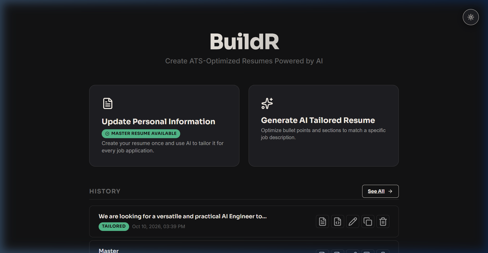
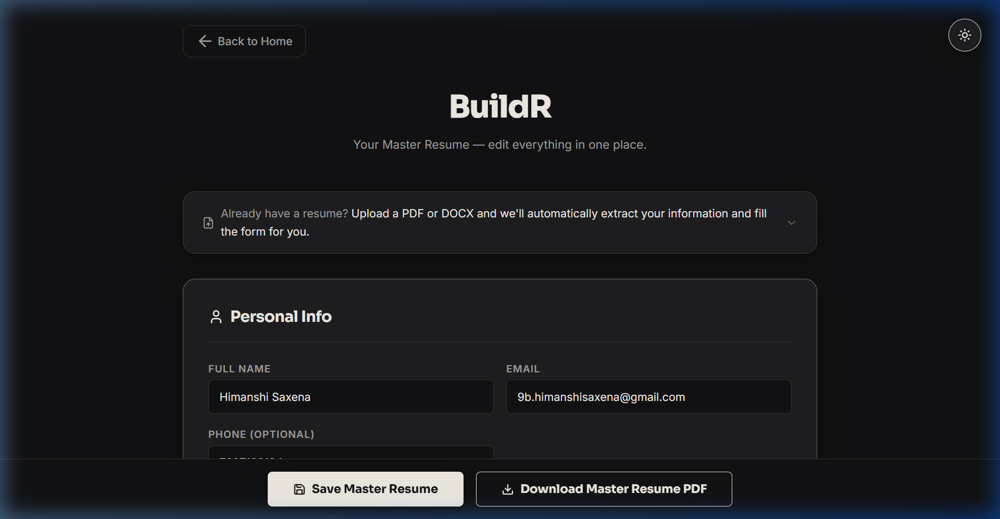
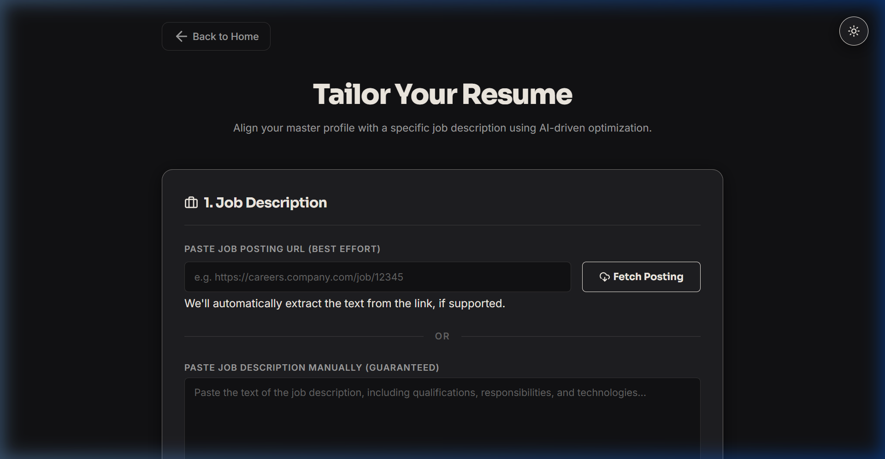
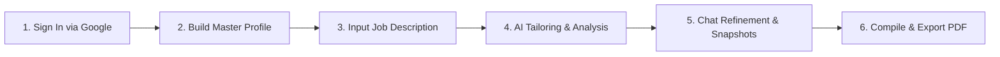

<div align="center">

  

  # BuildR

  ### **Create ATS-Optimized, Publication-Quality Resumes Tailored by AI**

  <p align="center">
    <a href="https://www.python.org/downloads/"></a>
    <a href="https://flask.palletsprojects.com/"></a>
    <a href="https://ai.google.dev/"></a>
    <a href="https://firebase.google.com/"></a>
    <a href="https://tectonic-typesetting.github.io/"></a>
    <a href="https://docs.pytest.org/"></a>
    <a href="LICENSE"></a>
  </p>

  <p align="center">
    <a href="#-key-features">Key Features</a> •
    <a href="#-screenshots">Screenshots</a> •
    <a href="#-software-stack--dependencies">Stack</a> •
    <a href="#-system-architecture">Architecture</a> •
    <a href="#-installation--local-setup">Installation</a> •
    <a href="#-usage-workflow">Usage</a> •
    <a href="#-configuration">Configuration</a> •
    <a href="#-privacy--security">Privacy & Security</a>
  </p>

</div>

---

## 📌 Overview

**BuildR** is an AI-powered Master Resume Builder and job-tailoring engine designed for modern developers and job seekers.

Traditional resume management is fragmented: maintaining dozens of slightly divergent Word docs or PDFs easily leads to outdated credentials, formatting inconsistencies, and broken layouts.

BuildR solves this with a **single source of truth and intelligent tailoring pipeline**:
1. You maintain **one comprehensive Master Profile** with all your career history, projects, skills, education, and credentials.
2. For every target position, BuildR analyzes the job posting and uses **Google Gemini** to intelligently rephrase bullet points, highlight relevant accomplishments, and surface missing keywords.
3. Your final tailored resume is compiled locally using **Tectonic LaTeX** into an elegant, ATS-friendly, publication-grade PDF.
4. **Google Authentication & Cloud Firestore Persistence**: Sign in securely with Google. Your profile data values and AI resume variations are stored in Google Cloud Firestore while PDFs remain strictly preserved on your local machine.

> **Zero-Hallucination Guarantee**: BuildR enforces a strict **anti-fabrication pipeline**. The AI is physically restricted from inventing companies, skills, or metrics that do not exist in your master profile.

> **Resilient Hybrid Storage**: Even with cloud Firestore persistence enabled, BuildR maintains a local filesystem cache (`storage/users/<uid>/`). If your network is offline or cloud credentials are not yet configured, the app falls back seamlessly without crashing.

---

## ✨ Key Features

- **🔐 Secure Google Authentication**
  Single Sign-On using Firebase Google Auth with protected routes and automatic user session isolation.
- **☁️ Cloud Firestore Database Persistence**
  Saves user details (Master Resume data) and AI variations (tailored resumes, LaTeX text, and metadata) directly to Firestore under user-scoped collections (`users/{user_id}`). *PDFs are never stored in the database.*
- **🎯 Single Master Profile**
  Manage all personal details, work experiences, education, open-source projects, technical skills, certifications, and awards in one structured database.
- **⚡ AI-Powered Tailoring Workspace**
  Paste a job description or provide a job posting URL. BuildR scrapes and extracts requirements, matches your profile against keywords, and rephrases your impact bullets to align with the target role.
- **🛡️ Strict Anti-Fabrication Safeguards**
  Unlike generic AI wrappers, BuildR includes an in-memory post-generation sanitizer that cross-references all generated entities against your Master Profile. Any hallucinated metrics or skills are filtered out, and missing role requirements are surfaced cleanly into a "Skills to Acquire" advisory list.
- **💬 Interactive AI Chat Refinement**
  Collaborate with the AI directly inside a dedicated scratchpad workspace. Ask for punchier bullets, adjust emphasis toward specific frameworks or metrics, and iterate until the draft is perfect.
- **📸 Named Draft Snapshots**
  Save checkpoints of your tailored drafts as you iterate. Compare iterations and roll back to previous snapshots with one click.
- **📄 One-Page Optimization Intelligence**
  Avoid messy 1.1-page resumes. If your content slightly spills over, BuildR automatically applies subtle typesetting adjustments: tightening line heights, pruning redundant bullets, and deduplicating tech stacks.
- **🖋️ Publication-Grade LaTeX Typesetting**
  Compiled locally via the **Tectonic** modern LaTeX engine. Delivers crisp typography, accurate margins, and optimal readability for both human recruiters and Automated Tracking Systems (ATS).
- **📚 Versioned Resume Library**
  Every generated resume is preserved with both its final PDF and reproducible `.tex` source code. Download, rename, duplicate, or delete anytime.
- **📥 PDF & DOCX Resume Importer**
  Already have an existing resume? Upload your PDF or DOCX file to automatically parse and populate your Master Profile using multimodal text extractors.

---

## 🖼️ Screenshots

<div align="center">

### Home Dashboard
*Quick access to your Master Profile, AI Tailoring workspace, and recent resume generations.*
<br/>


<br/><br/>

### Master Profile Editor
*Structured rich-text editing for work experience, projects, skills, education, and certifications.*
<br/>


<br/><br/>

### AI Tailoring & Analysis Workspace
*Analyze target job postings, inspect keyword match scores, and generate tailored resumes.*
<br/>


</div>

---

## 📦 Software Stack & Dependencies

### 1. System Prerequisites

| Tool | Recommended Version | What It Does |
|---|:---:|---|
| **Python** | `3.10+` | Runs the Flask backend, Pydantic data validation, AI service layer, and tests. |
| **Tectonic CLI** | `v0.15.0+` | A fast, self-contained modern XeTeX LaTeX engine that compiles `.tex` templates into PDFs locally. Downloads necessary packages into a local cache directory (`.tectonic/`) on first run. |
| **Git** | Modern version | Used to clone and manage the codebase. |
| **Modern Browser** | Chrome / Firefox / Edge / Brave / Safari | Renders the single-page application interface and displays real-time PDF previews. |

### 2. Python Packages (`requirements.txt`)

| Package | Version Constraint | Role & Execution |
|---|:---:|---|
| **`flask`** | `>=3.1, <4` | Core web framework powering routes, REST endpoints, session cookies, and file serving. |
| **`pydantic`** | `>=2.13, <3` | Strict data validation and schema definitions for profiles, tailoring results, and drafts. |
| **`openai`** | `>=1.50, <3` | Official SDK client used to communicate with Google Gemini's OpenAI-compatible endpoint. |
| **`firebase-admin`** | `>=6.5, <7` | Firebase Admin SDK for server-side token verification and Firestore cloud operations. |
| **`jinja2`** | `>=3.1, <4` | Template engine used to assemble clean LaTeX (`.tex`) resume source files. |
| **`pypdf`** | `>=6.14, <7` | Local text and layout extractor that parses user-uploaded `.pdf` resumes. |
| **`python-docx`** | `>=1.2, <2` | Extracts headings, paragraphs, and lists from user-uploaded `.docx` resumes. |
| **`beautifulsoup4`** | `>=4.15, <5` | HTML scraper that extracts structured job descriptions from job URLs. |
| **`requests`** | `>=2.34, <3` | HTTP client for external requests and Firestore REST API fallback. |
| **`psutil`** | `>=5.9, <7` | Process memory monitoring during text extraction to bound RAM usage. |
| **`python-dotenv`** | `>=1.2, <2` | Loads `.env` configuration file into environment variables at application startup. |

### 3. Local Storage Layout

User files are scoped strictly per authenticated user inside `storage/users/<user_id>/`:

```text
storage/
└── users/
    └── <firebase_uid>/
        ├── profile.json       # Master profile local cache
        ├── resumes/           # Saved resumes (each with resume.pdf, resume.tex, metadata.json)
        └── sessions/          # Tailoring scratchpads, drafts, and snapshot checkpoints
```

---

## 🏗️ System Architecture

```
┌─────────────────────────────────────────────────────────────┐
│                    Single-Page App (SPA)                    │
│   Vanilla JS • CSS Design System • TipTap Rich Text • PDF   │
└──────────────────────────────┬──────────────────────────────┘
                               │ REST API (127.0.0.1:5000)
                               ▼
┌─────────────────────────────────────────────────────────────┐
│               Flask Application (app.py)                    │
│    • Auth guard (@require_auth)  • Session Management       │
└──────┬───────────────────────┬──────────────────────────────┘
       │                       │
       ▼                       ▼
┌──────────────┐        ┌─────────────────────────────────────┐
       │                │          Services Pipeline          │
┌──────┴───────┐        │  • ai_service (Gemini 2.5 Flash)    │
│ Hybrid Cache │        │  • firestore_service (DB sync)      │
│ Local Disk   │        │  • firebase_service (Auth & Tokens) │
│ (storage/    │        │  • latex_service (Jinja2 + Escape)  │
│  users/<id>) │        │  • pdf_service (Tectonic Subprocess)│
└──────────────┘        │  • scraper_service (BeautifulSoup)  │
                        │  • parser_service (pypdf/docx)      │
                        │  • master_optimizer (1-page engine) │
                        └──────────────────┬──────────────────┘
                                           │
                                           ▼
                        ┌─────────────────────────────────────┐
                        │      Cloud & External Services      │
                        │  • Google Gemini API (Reasoning)    │
                        │  • Google Cloud Firestore (Database)│
                        │  • Firebase Auth (Google Sign-In)   │
                        │  • Tectonic Compiler (Local Binary) │
                        └─────────────────────────────────────┘
```

---

## 🚀 Installation & Local Setup

### Step 1: Install Tectonic LaTeX Compiler

- **Windows**:
  ```powershell
  winget install --id Anoma.Tectonic
  # or: choco install tectonic
  # or: scoop install tectonic
  ```
- **macOS**:
  ```bash
  brew install tectonic
  ```
- **Linux** (Debian / Ubuntu / Fedora / Arch):
  ```bash
  sudo pacman -S tectonic   # Arch
  # or download binary from https://github.com/tectonic-typesetting/tectonic/releases
  ```

*Verify Tectonic is available on your PATH:*
```bash
tectonic --version
```

---

### Step 2: Clone the Repository

```bash
git clone https://github.com/Hima-11-works/BuildR.git
cd BuildR
```

---

### Step 3: Create & Activate Virtual Environment

**Windows (PowerShell):**
```powershell
python -m venv env
.\env\Scripts\Activate.ps1
```

**macOS / Linux:**
```bash
python3 -m venv env
source env/bin/activate
```

---

### Step 4: Install Python Dependencies

```bash
pip install -r requirements.txt -r requirements-dev.txt
```

---

### Step 5: Configure `.env`

Copy the sample environment file:

```bash
cp .env.example .env
```

Open `.env` and fill in your Gemini API key and Firebase Web App credentials:

```env
# Google Gemini API key (https://aistudio.google.com/)
GEMINI_API_KEY=your_gemini_api_key_here
GEMINI_MODEL=gemini-2.5-flash

# Firebase Configuration (Firebase Console -> Project settings -> General -> Your apps)
FIREBASE_API_KEY=your_firebase_api_key
FIREBASE_AUTH_DOMAIN=your_project_id.firebaseapp.com
FIREBASE_PROJECT_ID=your_project_id
FIREBASE_STORAGE_BUCKET=your_project_id.firebasestorage.app
FIREBASE_MESSAGING_SENDER_ID=your_sender_id
FIREBASE_APP_ID=your_app_id
FIREBASE_MEASUREMENT_ID=G-XXXXXXXXXX

# Optional: Server Service Account (bypasses Firestore client rules)
# GOOGLE_APPLICATION_CREDENTIALS=serviceAccountKey.json

PORT=5000
FLASK_DEBUG=1
```

---

### Step 6: Start the Server

```bash
python app.py
```

Navigate to:
```
http://127.0.0.1:5000/
```
Sign in with your Google account to access your Master Profile and resume generator.

---

## 🧭 Usage Workflow



1. **Sign in with Google**:
   - Access is authenticated and scoped to your unique Google account.
2. **Build Your Master Profile**:
   - Fill in your work experience, education, projects, skills, and certifications in the profile editor.
   - Or upload an existing resume (`.pdf` or `.docx`) to seed your profile automatically via parser.
3. **Analyze a Target Job**:
   - Paste the job description or provide the URL of a public job posting.
   - Click **Analyze Job** to view matched keywords and extracted requirements.
4. **Generate Tailored Resume**:
   - Click **Generate Tailored Resume**.
   - BuildR rephrases experience bullets, highlights matching skills, and preserves strict truthfulness.
5. **Iterate with AI Chat**:
   - Use the live chat assistant to request adjustments (e.g., *"Make project bullets more metrics-focused"*).
   - Save named snapshots to compare versions.
6. **Download & Archive**:
   - Preview the compiled PDF directly in your browser.
   - Download the final PDF or export raw `.tex` source code.
   - Access all past resumes anytime in the **Resume Library**.

---

## ⚙️ Configuration Reference

| Variable | Required | Default Value | Description |
|---|:---:|---|---|
| `GEMINI_API_KEY` | **Yes** | — | Google Gemini API key (from AI Studio) |
| `GEMINI_BASE_URL` | No | `https://generativelanguage.googleapis.com/v1beta/openai/` | OpenAI-compatible Gemini gateway |
| `GEMINI_MODEL` | No | `gemini-2.5-flash` | Gemini model name |
| `GEMINI_TIMEOUT_MS` | No | `90000` | Gemini HTTP timeout in milliseconds |
| `FIREBASE_API_KEY` | **Yes** | — | Firebase Web API key |
| `FIREBASE_AUTH_DOMAIN` | **Yes** | — | Firebase authentication domain |
| `FIREBASE_PROJECT_ID` | **Yes** | — | Firebase/GCP Project ID |
| `FIREBASE_STORAGE_BUCKET` | No | — | Firebase Storage bucket identifier |
| `FIREBASE_MESSAGING_SENDER_ID`| No | — | Firebase Messaging Sender ID |
| `FIREBASE_APP_ID` | **Yes** | — | Firebase App ID |
| `FIREBASE_MEASUREMENT_ID` | No | — | Google Analytics Measurement ID |
| `GOOGLE_APPLICATION_CREDENTIALS` | No | — | Optional path to service account key JSON |
| `SECRET_KEY` | No | `dev-fallback-key` | Secret key used to cryptographically sign Flask session cookies |
| `FLASK_DEBUG` | No | `0` | Enable dev server auto-reloading (`1` for development) |
| `PORT` | No | `5000` | Port for the local web server |

---

## 🧪 Running Tests Locally

BuildR includes an automated test suite (194 tests) covering routes, LaTeX rendering, anti-fabrication sanitizers, document extractors, session storage, and Firestore persistence:

```bash
# Run the full test suite
pytest

# Run with verbose output
pytest -v

# Run Firestore persistence tests
pytest tests/test_firestore_service.py -v

# Run anti-hallucination sanitizer tests
pytest tests/test_ai_sanitize.py -v
```

---

## 🔒 Privacy & Security

- **Strict User Scoping**: All user data, drafts, and resume archives are scoped to the authenticated user's ID (`storage/users/<uid>/` and `users/{user_id}`).
- **No Remote PDFs**: PDFs are compiled locally using Tectonic and never sent to or stored in Firestore.
- **Anti-Fabrication Guarantee**: AI suggestions are cross-checked against your master profile to block hallucinated accomplishments.
- **Resilient Fallback**: If Firestore is unreachable, the system falls back to the local encrypted cache transparently.

---

## 📂 Project Structure

```text
BuildR/
├── app.py                      # Flask REST router, auth guard & server entrypoint
├── requirements.txt            # Production Python dependencies
├── requirements-dev.txt        # Development dependencies (pytest)
├── .env.example                # Sample environment configuration template
│
├── assets/                     # Screenshots and brand assets for documentation
│   ├── logo.png                # BuildR brand logo
│   ├── home_preview.png        # Home dashboard preview
│   ├── builder_preview.png     # Master profile builder preview
│   └── tailor_preview.png      # AI tailoring workspace preview
│
├── models/                     # Pydantic data schemas
│   ├── profile.py              # Canonical Master Profile schema
│   ├── tailored_profile.py     # Schema for tailored profile output
│   └── tailoring_result.py     # Results model (match scores, suggestions, profile)
│
├── services/                   # Modular service layer
│   ├── ai_service.py           # Gemini client, structured prompts & sanitizer
│   ├── auth_service.py         # Session management, user roots & route decorators
│   ├── firebase_service.py     # Firebase Admin SDK & token verifier
│   ├── firestore_service.py    # Cloud Firestore persistence (profiles & variations)
│   ├── latex_service.py        # Jinja2 LaTeX template renderer & Unicode escaper
│   ├── pdf_service.py          # Tectonic compiler wrapper & page counter
│   ├── parser_service.py       # PDF / DOCX resume extractor
│   ├── scraper_service.py      # Job posting web scraper
│   ├── master_optimizer.py     # One-page layout optimization intelligence
│   ├── storage_service.py      # Master profile persistence (Firestore + local cache)
│   ├── resume_library.py       # Generated resume catalog and version management
│   └── session_service.py      # Workspace scratchpad session manager
│
├── templates/                  # Frontend HTML
│   ├── index.html              # Single-page application shell
│   └── login.html              # Google sign-in authentication page
├── static/                     # Frontend JS & CSS
│   ├── app.js                  # SPA controller, TipTap editor & PDF viewer
│   └── style.css               # Design system & dark/light theme styles
├── templates_latex/            # LaTeX Jinja2 templates
│   └── resume.tex              # Clean ATS resume template
│
└── tests/                      # Automated test suite (194 tests)
    ├── conftest.py             # Shared pytest fixtures & test client setup
    ├── test_ai_sanitize.py     # Anti-fabrication fuzzing & validation tests
    ├── test_app_routes.py      # Flask API endpoint integration tests
    ├── test_firestore_service.py # Firestore persistence & schema tests
    ├── test_latex_service.py   # LaTeX escaping and formatting tests
    ├── test_master_optimizer.py# One-page layout optimizer tests
    ├── test_parser_service.py  # Resume text extraction tests
    ├── test_pdf_service.py     # PDF compilation tests
    ├── test_resume_library.py  # Storage and library management tests
    └── test_session_service.py # Tailoring session manager tests
```

---

## 📄 License

This project is licensed under the MIT License — see the [LICENSE](LICENSE) file for details.

---

<div align="center">
  <sub>Built with ❤️ by <a href="https://www.linkedin.com/in/himanshi-saxena-6094bb326/">Himanshi Saxena</a></sub>
</div>
